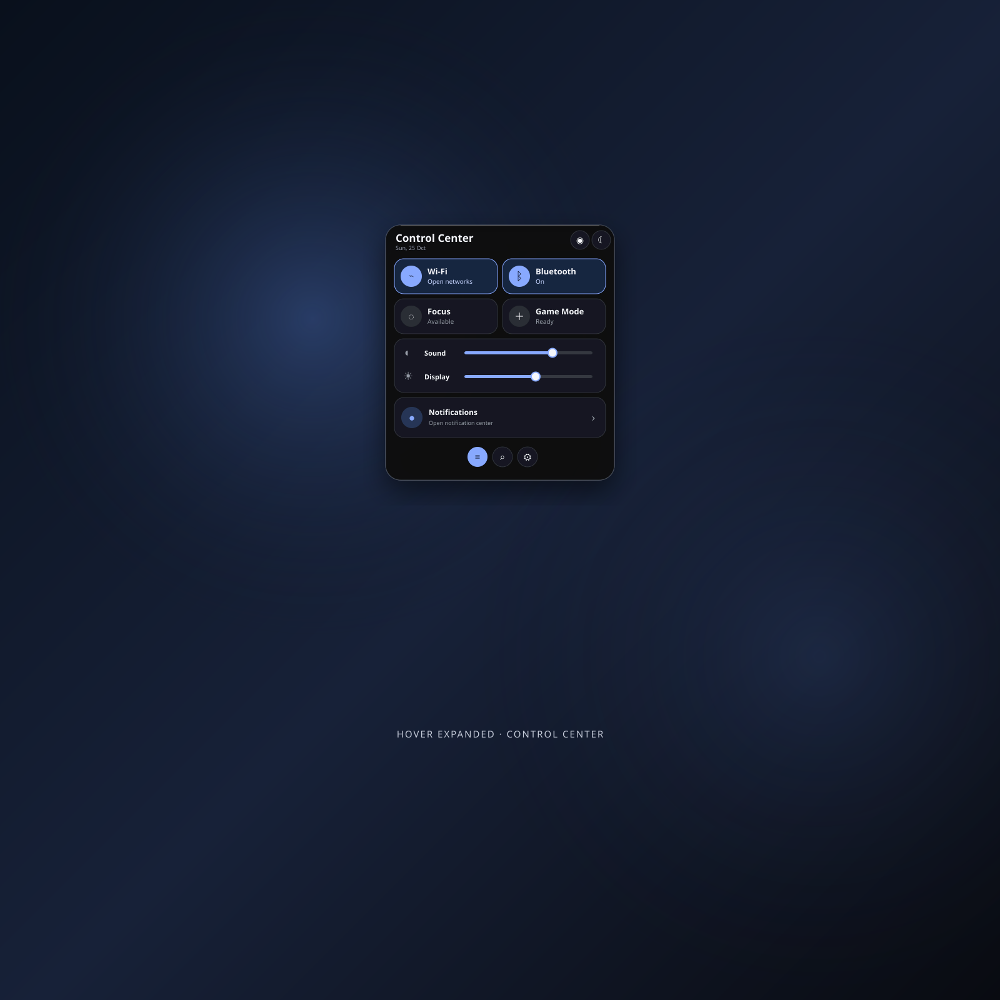
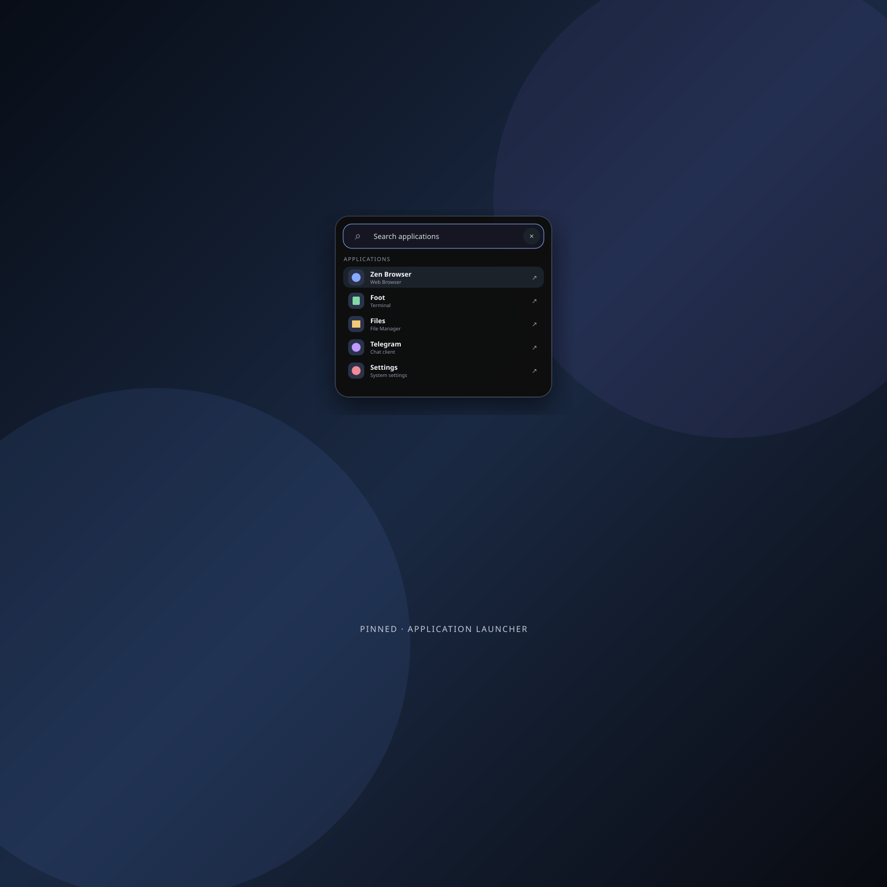
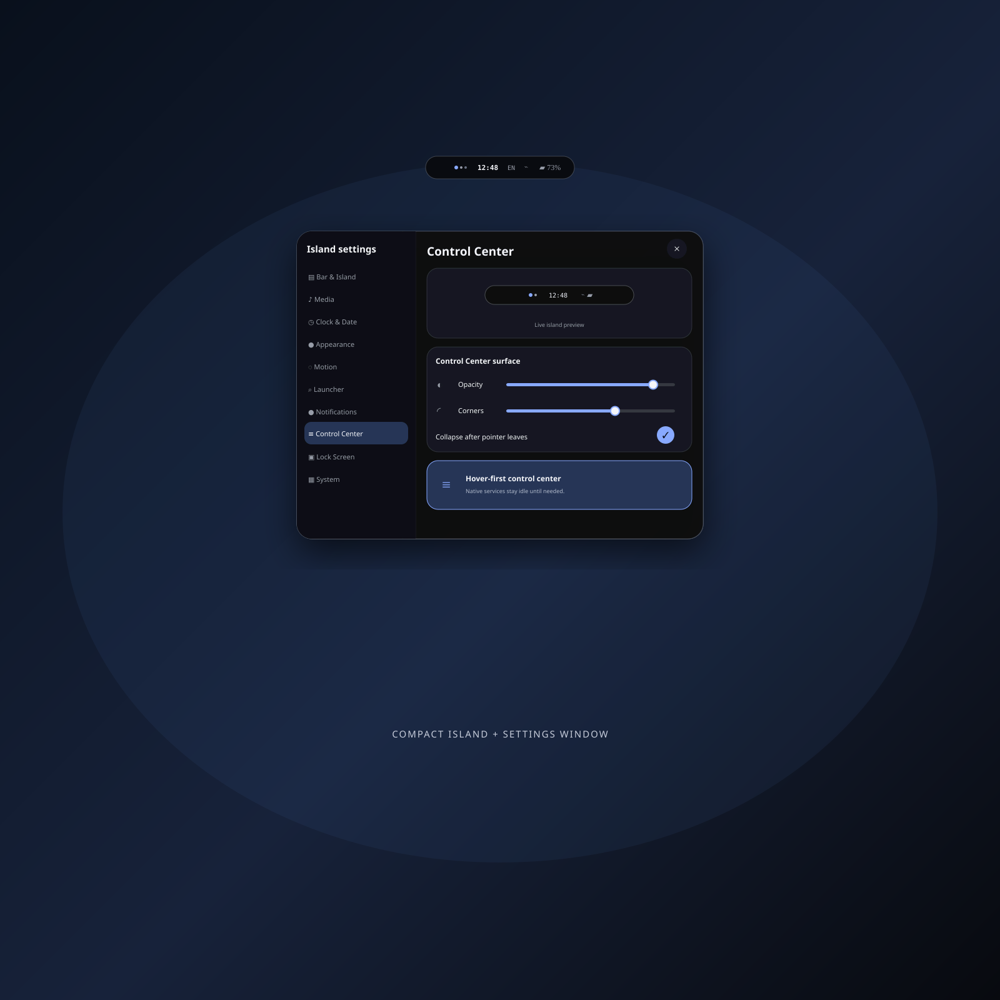

# Repo-local Quickshell island

This shell is independent from `bar/` and is intentionally not autostarted. Run
it directly from the checkout for immediate QML reloads:

```sh
qs --path ~/nix/home-manager/modules/quickshell/island
```

The existing bar remains at:

```sh
qs --path ~/nix/home-manager/modules/quickshell/bar
```

IPC entry points (replace the path if the checkout lives elsewhere):

```sh
qs ipc -p ~/nix/home-manager/modules/quickshell/island call island toggle
qs ipc -p ~/nix/home-manager/modules/quickshell/island call island launcher
qs ipc -p ~/nix/home-manager/modules/quickshell/island call island settings
qs ipc -p ~/nix/home-manager/modules/quickshell/island call island close
```

The compact pill expands on hover. Clicking the pill pins it; leaving an
unpinned surface collapses it after a short grace period.

## Preview

| Control center | Launcher | Settings |
| --- | --- | --- |
|  |  |  |
